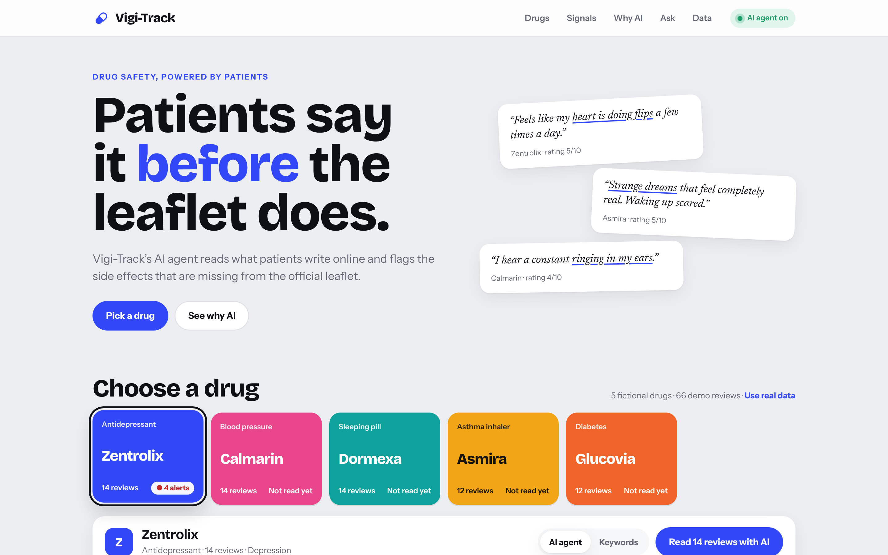
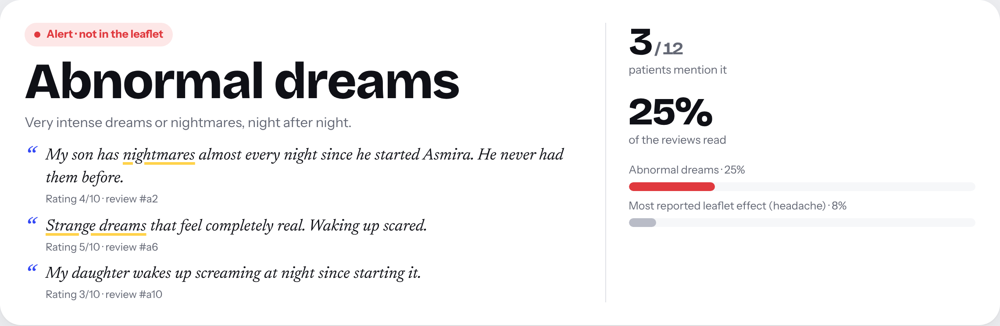

# Vigi-Track

**Patients say it before the leaflet does.**

An AI agent that reads patient reviews and flags the drug side effects missing from the official leaflet.

Final project, AI for Business, ESSEC.

Before launch, a drug is tested on a few thousand patients. After launch, millions of people take it for years, and rare side effects only show up then. Most of them are never reported to the authorities. Patients do talk about them online.

Vigi-Track reads patient reviews of a drug. An AI agent lists the side effects each patient really had. The app compares them with the official leaflet and turns every effect that is **not in the leaflet** into an alert for the safety team. The agent can then write a short signal report.





## What is in this folder

| Folder | Content |
|---|---|
| `app/index.html` | The whole app in one file (HTML, CSS, JavaScript). |
| `data/demo_reviews.csv` | 66 demo reviews for 5 **fictional** drugs, in the same format as the Drugs.com dataset. |
| `data/leaflet_known_effects.csv` | The side effects listed in each demo leaflet. |
| `docs/USER_GUIDE.pdf` | Step by step user guide with screenshots. |
| `PROMPTS.md` | Every prompt used, in the app and to build the project. |
| `video/Vigi-Track-demo.mp4` | The demo video (1080p, 2 min 37, with music). |
| `video-tools/` | Scripts that filmed the demo (`film.html` for the animated scenes, `record.py`) and generated the music (`music.py`). |

## Try it now

**[Open Vigi-Track in Claude](https://claude.ai/artifact/DgS7dT4zHKniHtZe1xF8pX)**. Nothing to install. The AI agent runs on your own Claude account.

## How to run it

**Option 1. In Claude (easiest).** Open the [published app](https://claude.ai/artifact/DgS7dT4zHKniHtZe1xF8pX) in claude.ai. The AI agent runs on your Claude account. Nothing to install.

**Option 2. On your computer.**
1. Download this folder.
2. Open `app/index.html` in Chrome, Edge or Firefox.
3. Keyword mode works straight away.
4. To turn on the AI agent, go to **Data and settings**, paste an Anthropic API key and click **Use key**. The key stays in the browser tab. It is only sent to `api.anthropic.com`.

The app needs an internet connection for its fonts, the CSV reader (Papa Parse, from cdnjs) and the AI calls.

## Data

The app opens with the demo sample already loaded. These reviews were written for the demo. The drug names (Zentrolix, Calmarin, Dormexa, Asmira, Glucovia) are invented, so no real medicine is described.

For real data, use the public **Drugs.com review dataset** (215,063 reviews):
- UCI Machine Learning Repository, "Drug Review Dataset (Drugs.com)"
- Kaggle, "UCI ML Drug Review dataset"

Download `drugsComTrain_raw.csv` (or the `.tsv` version) and load it with **Upload a file** in Data and settings. The app reads the columns `drugName`, `condition`, `review`, `rating` and `usefulCount`. With real data, the leaflet is empty at first. You tick the known effects yourself, from the drug's official leaflet.

## How it works

1. **Reviews** are loaded from the demo sample or the Drugs.com file.
2. **AI extraction.** A large language model (Claude) reads the reviews in batches of 20. For each review, it returns the side effects the patient really had, as JSON. It ignores effects the patient denies ("no nausea"), only fears, or that belong to the illness. This is zero-shot: no training data is needed.
3. **Normalisation.** Terms are mapped to a shared vocabulary of 25 effects (for example "heart racing" becomes palpitations).
4. **Leaflet check.** Each effect is marked "in leaflet" or "not in leaflet".
5. **Alerts.** One card per effect not in the leaflet, with counts, share of reviews and the patients' own words. A live tester compares the AI with a keyword search on any sentence.
6. **Agent with tools.** The agent can call two functions of the app, `get_signal_summary` and `get_reviews_for_effect`. It reads the results and the reviews, then answers the safety team.

Keyword mode uses regular expressions on the same vocabulary. It is the baseline, close to the bag of words seen in class. The "Why AI" section shows its errors, like negations it counts by mistake and paraphrases it misses.

## Going beyond the course

In class we built a bag of words and counted words. Vigi-Track uses a large language model that reads the whole sentence, plus an agent that decides which tools to call before it answers. The app also keeps a human in the loop. The agent advises, and experts decide.

## Limits

- A weak signal is a hypothesis, not a proof. It must be checked against official data (ANSM, EMA EudraVigilance, FDA FAERS).
- Online reviews are unverified, and reviewers are not a random sample of patients.
- The AI can make mistakes. Every signal links back to the real quotes so people can check.
- Not medical advice.

## Reproduce the demo video

```bash
cd video-tools
npm install          # Papa Parse and the fonts used offline
pip install playwright numpy
python3 record.py    # films intro, app and outro, adds the music, writes video/Vigi-Track-demo.mp4
```

`record.py` needs Chromium (via Playwright) and ffmpeg. During filming, `mock.js` stands in for Claude so the video can be recorded offline with the same answers every time. The published app uses the real Claude. `music.py` generates the background music from code, so it is royalty free.
